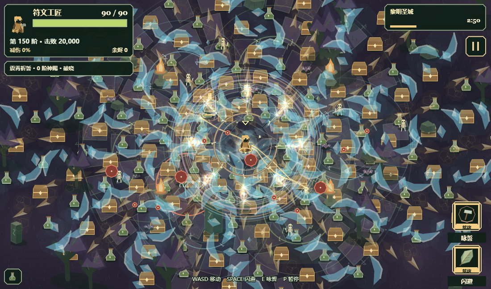
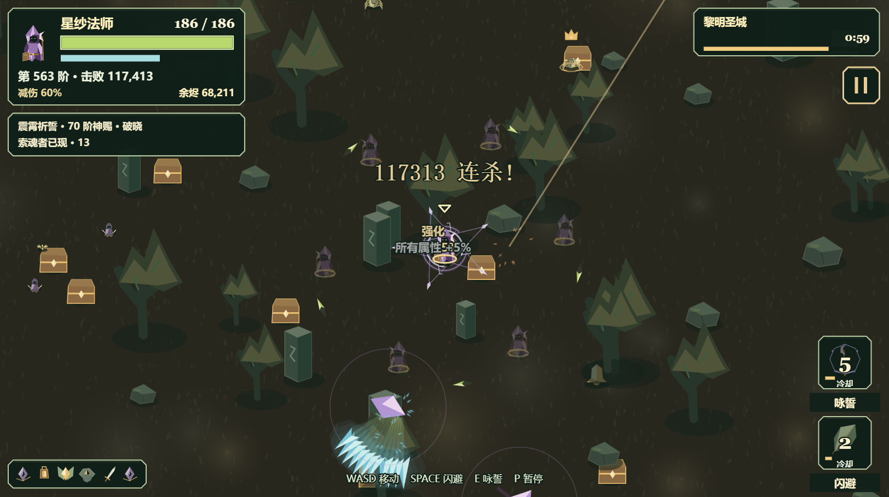

# 长夜余烬：最终版零/中成长长局与后期演出（2026-11-05）

从已发布 ecfd37… 包重新正常跑四局，再以最终优化包 545c129cf446 从头跑四局。每组均为正常五章二十分钟；运行中不热替换代码。中间缓存版四次约三分钟短测主动暂停，单列为短测，不能算通关或失败。

## 条件

使用 Edge 浏览器隔离内存存档，零成长无誓印、天赋、宠物或光环；中成长通过正常购买建立生命5、伤害5、移速4、拾取3、冷却3、恢复3、暴击2。零成长初始货币0；中成长预置10000营地货币仅用于正常购买。通过正常首页选角祈誓、双助手按钮和E输入尝试技能。局内不设无敌、不注入装备、奖励或计数、不跳时间。每一局保留原生随机选择；不是相同种子的胜率或平衡对照。

每页四个1100×760逻辑视口，实际战斗画布1083×606、像素1624×909，DPR1.5。两页长局有重叠运行，阶段CPU数据受并行负载影响；窗口没有持续保持前台，帧间隔不得用作前台30/60FPS验收。

## 完整记录

| 来源 | 组合 | 结果 | 击败 | 阶数 | 普通觉醒事件 | 自然融合ID | 脚本错误 |
| --- | --- | --- | ---: | ---: | ---: | --- | ---: |
| 原最终版 | 中成长 · 符文工匠 / 余铸 | 20:00 胜利 | 78,770 | 374 | 6 | 本局未融合 | 0 |
| 原最终版 | 中成长 · 星纱法师 / 震霄 | 20:00 胜利 | 125,048 | 611 | 6 | 本局未融合 | 0 |
| 原最终版 | 零成长 · 毒枝术士 / 青萝 | 20:00 胜利 | 81,452 | 382 | 7 | fusion_cryo_toxic | 0 |
| 原最终版 | 零成长 · 暮影刺客 / 曦衡 | 20:00 胜利 | 45,953 | 367 | 6 | 本局未融合 | 0 |
| 优化最终版 | 中成长 · 符文工匠 / 余铸 | 20:00 胜利 | 73,602 | 428 | 6 | 本局未融合 | 0 |
| 优化最终版 | 中成长 · 星纱法师 / 震霄 | 20:00 胜利 | 130,765 | 629 | 6 | 本局未融合 | 0 |
| 优化最终版 | 零成长 · 毒枝术士 / 青萝 | 20:00 胜利 | 56,491 | 328 | 6 | 本局未融合 | 0 |
| 优化最终版 | 零成长 · 暮影刺客 / 曦衡 | 20:00 胜利 | 70,246 | 476 | 6 | 本局未融合 | 0 |

觉醒事件包含融合消耗材料后新获武器的再次觉醒，不能与终局格位数等同。全部终局由实际页面结算文字及本局事件核验。

## 修复

- 普通投射物的静态切面缓存复用，动态符文、旋转、透明度仍实时绘制。缓存最多48项、4,194,304像素（约16MiB原始RGBA，不包含浏览器开销），小数半径也受约束。大范围普通弹体保留完整矢量命中环，缓存18像素核心；三类融合大领域继续矢量绘制。
- 仅按屏内友方弹量平滑降低友方透明度：64个以内原亮度，192个及以上为55%，中间线性过渡；仍叠加靠近角色的淡化。屏外弹体不影响这项计数，所有核心与伤害边界保留，敌弹、红色预警和HUD不淡化。
- 不调整伤害、冷却、命中范围或存档；这组样本未构成新的强弱失衡证据。

## 性能与视觉

独立源版本画布、同样输入，交替顺序，预热8次、采样80次。六个领域、八种神赐、两种主动技能；普通弹丸保留原随机相位。下表为CPU绘制P95，不能换算为GPU帧率。

| 构造输入 | 细节 | ecfd37 原版(ms) | 优化版(ms) |
| --- | --- | ---: | ---: |
| 70弹体 / 90拾取物 | 高 | 25.8 | 22.5 |
| 70弹体 / 90拾取物 | 低 | 5.9 | 4.7 |
| 480弹体 / 180拾取物 | 高 | 34.8 | 28.8 |
| 480弹体 / 180拾取物 | 低 | 31.6 | 26.5 |
| 0弹体 / 180拾取物 | 高 | 6.5 | 6.6 |
| 0弹体 / 180拾取物 | 低 | 4.3 | 4.1 |

六种融合以真实fire/draw路径检查高低细节，绘制夹具独立于自然长局记录。高压夹具和多实例实战仍有偶发长调用，本轮不宣称完全消除卡顿。230项全仓测试通过；其后加强密集弹幕/屏外弹幕/敌弹层级的真实绘制回归后13项特效检查通过。

逐局来源、成长快照、阶段采样、觉醒融合事件与终局文字见[数据](../reports/emberfall-final-zero-mid-2026-11-05.json)。原始直方图、短测、截图和检查源码在本地outputs/final-longrun-2026-11-05保留。临时测试页不发布。
