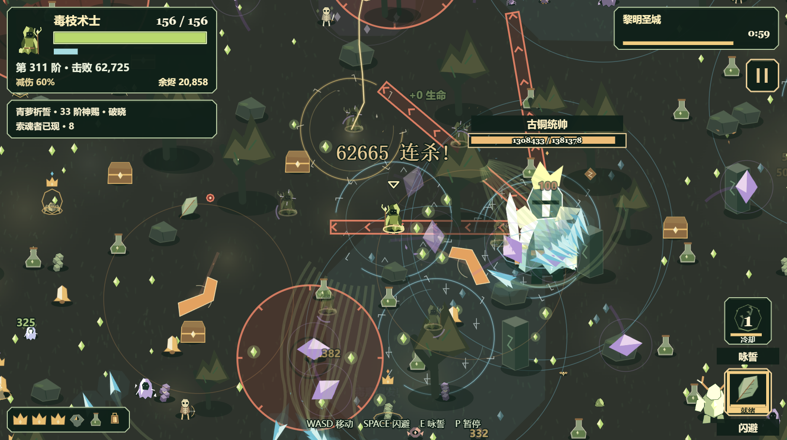

# 长夜余烬：融合选材、随缘选择与正常长局（2026-11-05）

## 原因与处理

上一轮四组最终行装各有六件满级/觉醒武器，但没有一条完整双武器配对；首领击败数为6、7、8、10。随缘优先普通觉醒、已有被动与稀有选项，不主动找融合搭档；新武器可能先把六格占满。宝箱中的随缘则完全随机，已出现的融合也可能跳过。

- `FusionGuidance` 从已持有材料寻找可行路线，双材料已持有的路线优先；单武器试炼、放逐和满格限制照常生效，不追已完成的融合。
- 第8阶起，每4阶保留一份路线材料选项；只剩最后空位时及时提供缺失搭档，已就绪融合优先保留。五选一的神赐不挤掉融合。提供的是可选择馈赠，仍需玩家/随缘实际选中。
- 随缘先把起手武器磨到三级，再选择可用配方的第一件材料、补搭档并磨满；起手没有融合路线的角色也能建立路线。融合武器固定一级时按其实际满级上限判断，不阻止后续选材和神赐。
- 保留低血治疗及恢复神赐优先，按原每六阶规则考虑同神明神赐，再追材料，避免材料长期挤占神赐成长。宝箱危急时先治疗，否则优先融合，再普通觉醒。
- 强化界面直接显示目标融合、两件材料各自等级、真实试炼进度；卡片先显示融合提示。满格且没有可行路线时提示材料阻塞。缺搭档、缺试炼、已就绪和满格四态均走过实际网页绘制。

融合仍需两件材料满级及原试炼；本次没有降低首领/冻结击败门槛，没有修改武器伤害、冷却、范围或神赐数值。

## 最终包正常长局

最终 LF SHA256：`8f312b72e1737dbb22204e7d21c19ec0123e9dafc5455f685190a9a090a140ee`。四局从头加载同一最终包，运行中不热替换。

| 组合 | 结局 | 击败 | 自然融合时间与结果 | 脚本错误 |
| --- | --- | ---: | --- | ---: |
| 中成长 · 符文工匠 / 余铸 | 20:00 胜利 | 65,048 | 03:48 寒毒结界、09:36 黎明天罚 | 0 |
| 中成长 · 星纱法师 / 震霄 | 20:00 胜利 | 133,030 | 05:37 吞星之瞳、07:26 霜腐幽潭、08:43 血棘龙卷 | 0 |
| 零成长 · 毒枝术士 / 青萝 | 20:00 胜利 | 70,171 | 02:42 寒毒结界、07:35 吞星之瞳、10:09 终夜焰风 | 0 |
| 零成长 · 暮影刺客 / 曦衡 | 20:00 胜利 | 64,249 | 04:02 寒毒结界、11:40 吞星之瞳 | 0 |

全程正常二十分钟结构，Edge浏览器隔离内存存档，正常首页选角祈誓、游戏原生随行与随缘、E输入尝试技能；不注入局内装备、奖励、计数、无敌或时间。零成长初始货币0，无誓印/天赋/宠物/光环；中成长预置10000营地货币，通过正常购买建立生命5、伤害5、移速4、拾取3、冷却3、恢复3、暴击2。

每组4个1100×760逻辑视口，战斗画布1083×606、1624×909像素，DPR1.5；双神补测为2个视口。候选与最终页有重叠运行，窗口未持续保持前台，阶段CPU受并发负载影响，帧间隔不作前台FPS验收。239项全仓检查通过。

## 候选、失败与停止记录

以下来源均为中间版本，不能算作最终包胜率。奖励保留原生随机，未做同种子胜率对照。主动停止的短测在数据中单列，未冒充通关或战败。

| 来源前缀 | 组合 | 结局 | 自然融合 |
| --- | --- | --- | --- |
| e36a0b181f8e | 中成长 · 符文工匠 / 余铸 | 20:00 胜利 | 06:01 吞星之瞳、11:05 黎明天罚 |
| e36a0b181f8e | 中成长 · 星纱法师 / 震霄 | 20:00 胜利 | 04:18 血棘龙卷、06:32 黎明天罚 |
| e36a0b181f8e | 零成长 · 毒枝术士 / 青萝 | 20:00 胜利 | 03:09 寒毒结界、10:01 吞星之瞳、13:04 霜腐幽潭 |
| e36a0b181f8e | 零成长 · 暮影刺客 / 曦衡 | 20:00 胜利 | 08:11 血棘龙卷 |
| 037abc04ce2a | 中成长 · 符文工匠 / 余铸 | 20:00 胜利 | 03:28 血棘龙卷、09:26 吞星之瞳、12:08 霜腐幽潭 |
| 037abc04ce2a | 中成长 · 星纱法师 / 震霄 | 20:00 胜利 | 03:36 寒毒结界、06:36 黎明天罚、11:21 霜腐幽潭、11:29 血棘龙卷 |
| 037abc04ce2a | 零成长 · 毒枝术士 / 青萝 | 20:00 胜利 | 02:50 寒毒结界、07:14 吞星之瞳、09:51 血棘龙卷 |
| 037abc04ce2a | 零成长 · 暮影刺客 / 曦衡 | 04:04 战败 | 未融合 |
| 037abc04ce2a | 零成长 · 暮影刺客 / 凝月 | 05:39 战败 | 未融合 |
| e599ed9f587c | 零成长 · 毒枝术士 / 青萝 | 05:41 战败 | 03:14 寒毒结界 |
| e599ed9f587c | 零成长 · 暮影刺客 / 曦衡 | 05:14 战败 | 04:21 血棘龙卷 |

过程中的零成长失败全部保留。追材料曾挤占神赐节奏，最终恢复每六阶神赐，并修正一级满级融合的判定；没有以降低敌人伤害或强塞装备制造通关。个别失败不能据此证明唯一死因或普遍胜率。

逐次选项、材料前后ID与等级、真实副武器消耗、阶段记录和终局文字见[数据](../reports/emberfall-fusion-guidance-2026-11-05.json)。原始直方图、UI夹具、早期中止与截图在本地outputs/fusion-guidance-2026-11-05保留；测试页不发布。
