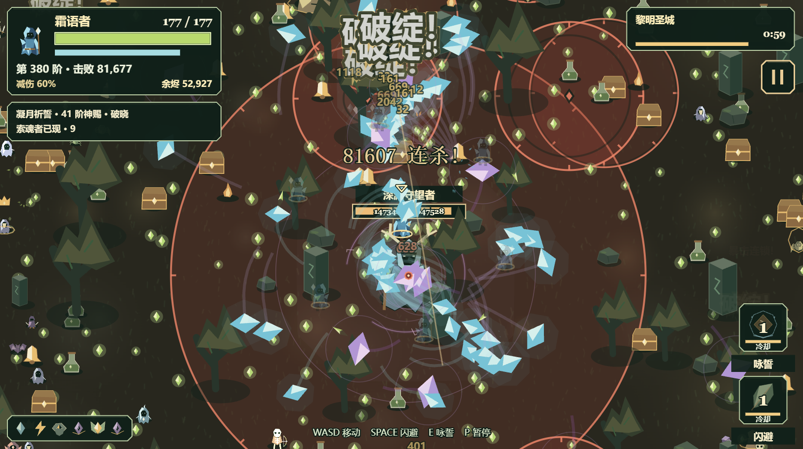
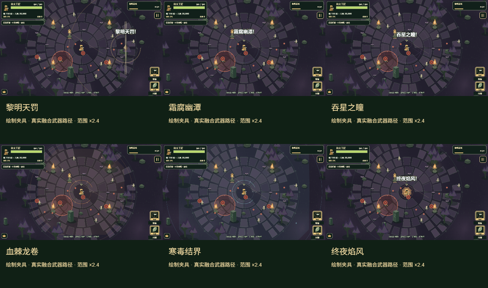
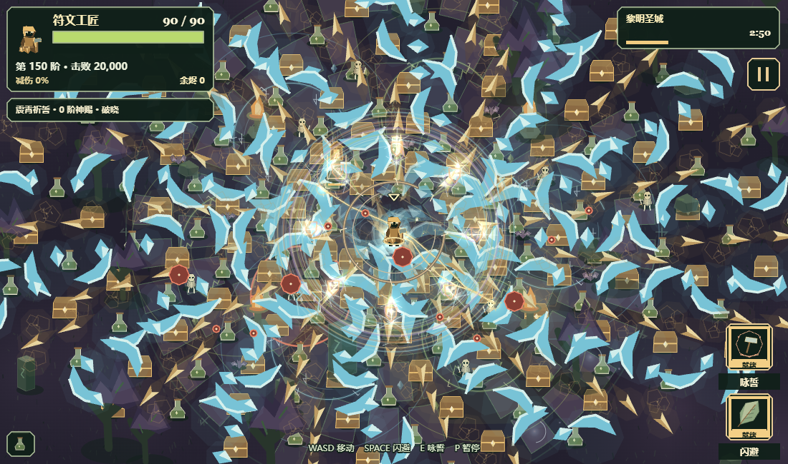

# 长夜余烬：后期特效长局复查（2026-11-02）

三组不同守夜者与神明在浏览器正常速度下完成二十分钟，终局文字与数据均已确认。长局使用发布版 `7ee8244…`；据此修正友方特效遮挡和重复绘制开销。修复版源码另有六种融合、密集绘制夹具、正常三分钟战斗与 229 项检查，不能写成三局都已在修复版重新通关。

## 正常长局

| 组合 | 结局 | 击败敌人 | 普通觉醒次数 | 终局融合 | 咏誓施放 |
| --- | --- | ---: | ---: | --- | ---: |
| 霜语者 / 凝月 | 20:00 · 通关 | 91,484 | 6 | 本局未融合 | 104 |
| 符文工匠 / 余铸 | 20:00 · 通关 | 90,413 | 7 | 霜腐幽潭 | 124 |
| 星纱法师 / 震霄 | 20:00 · 通关 | 131,167 | 7 | 寒毒结界、吞星之瞳 | 172 |

中等营地快照：生命 5、伤害 5、移速 4、拾取 3、冷却 3、恢复 3、暴击 2，无天赋、宠物、光环。只在隔离内存存档预置营地货币，并通过原购买方法建立快照；局内依照正常强化、章节奖励和双助手流程，不注入武器、奖励、计数或无敌，不加速、不跳章节。普通觉醒次数为实际觉醒事件次数，融合消耗后新获武器的觉醒也计入，不能与终局六件行装数混淆。

## 修复

- 友方投射物靠近角色时平滑淡化到 32%，远处恢复全亮；不改变其坐标、半径或伤害。
- 友方技能绘制后回补同一皮肤的角色本体，再绘制定位标记与敌弹；不重复拖影、宠物或光环，避免多重神赐把角色中心照成白点。
- 高细节每帧最多 48 份普通投射物装饰，为融合光柱/奇点等另留 8 份；低细节关闭这部分装饰。所有核心弹丸和完整命中边界继续绘制，技能与神赐仍共用 8/4 组预算。
- 荆萤随行和连雷目标命中光晕正确遵守低细节开关。
- 静态宝箱、药剂和地图拾取物复用 96×96 模型缓存；位置和逐件透明度照常更新，未知类型共用一个回退项，避免缓存无限增长。
- 命中飘字紧凑显示长小数与大数；改动只在绘制层，不改实际伤害。

## 绘制与性能复查

六种融合均使用真实武器 `fire` / `draw` 路径检查高低细节，未出现脚本错误。下图是范围 ×2.4 的构造绘制夹具，不是自然获得全部融合的实战录像。

修复前后使用独立画布，交替顺序取样；每档预热 8 次、采样 80 次。各场景含六个领域、八种神赐和两种主动技能。数值是绘制 CPU P95（ms），包括命令提交及可能的后端等待，不能换算为 GPU 帧率；普通弹丸相位保留原初始化抖动，位置、数量、尺寸与主题固定。

| 构造输入 | 细节 | 修复前 | 修复后 |
| --- | --- | ---: | ---: |
| 70 投射物 / 90 拾取物 | 高 | 15.5 | 13.2 |
| 70 投射物 / 90 拾取物 | 低 | 10.8 | 8.3 |
| 480 投射物 / 180 拾取物 | 高 | 125.0 | 57.9 |
| 480 投射物 / 180 拾取物 | 低 | 67.0 | 47.7 |
| 0 投射物 / 180 拾取物 | 高 | 26.1 | 19.1 |
| 0 投射物 / 180 拾取物 | 低 | 24.1 | 14.7 |

极端输入修复后仍超过 33 ms，不能据此宣称稳定 30/60 FPS。初次共用画布交替探测出现明显顺序波动，因此接受独立画布探测，初始记录仍保留在本地。

用户本轮无法保持 Chrome 前台，三局的可见画布仍有真实绘制采样，但遮挡/后台调度使帧间隔不适合前台帧率验收。帧间隔直方图在 200 ms 饱和，相关分位数为「至少 200 ms」，不能按精确 200 ms 解释。

最终源码另以符文工匠 / 余铸正常运行至少 180 秒后主动暂停，未发现脚本错误；它是短段回归，不计作通关。全部 229 项检查通过，覆盖友方淡化后敌弹恢复全亮、角色回补顺序、装饰预算、缓存边界、低细节辉光与紧凑飘字。伤害、冷却、范围和存档逻辑未修改。

最终包按 LF 统一换行 SHA256：`ecfd37d280ffa771205c10e8491f4cdc53e78424e328c4a44658e44721482ff3`。逐项数据见 [报告](../reports/emberfall-late-vfx-2026-11-02.json)。临时本地检查页不发布，原始直方图、检查源码、失败夹具尝试及实战画布保留在本地 `outputs/late-vfx-2026-11-02` 和 `outputs`。
