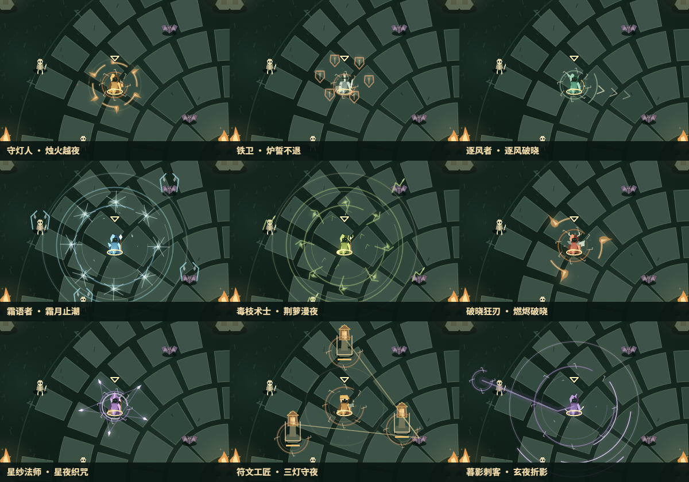

# 长夜余烬：技能演出升级

技能演出统一采用林地、余烬、旧神符文的配色，增加局部辉光、动态火舌、折光冰晶、雷击亮芯、荆枝、暮影轨迹和命中碎光。角色施放、持续、收束读取现有技能年龄，伤害仍按原时机结算；数值、碰撞半径、冷却、武器 ID 和存档格式没有修改。

[九名守夜者的 22.7 秒演出预览](assets/emberfall-vfx/skills.mp4)。视频为放大的循环绘制夹具，展示真实渲染器，不能当作实战或通关录像。

## 角色与神明

| 守夜者 / 咏誓 | 主要演出 |
| --- | --- |
| 守灯人 / 烛火越夜 | 绕身火舌、烛火亮芯、残影余炭与扩散回声 |
| 铁卫 / 炉誓不退 | 环绕的盾面、边角高光与炉誓刻痕 |
| 逐风者 / 逐风破晓 | 沿朝向推进的风羽箭纹与流动瞄准弧 |
| 霜语者 / 霜月止潮 | 扩散霜环、雪晶亮点和目标上的折光冰棘 |
| 毒枝术士 / 荆萝漫夜 | 生长荆枝、叶片光点和目标上的攀生痕迹 |
| 破晓狂刃 / 燃烬破晓 | 旋转刃弧、动态火舌与燃烬光芯 |
| 星纱法师 / 星夜织咒 | 旋转星轨、交织星线与发光星核 |
| 符文工匠 / 三灯守夜 | 符灯落地光柱、铸造刻印和环绕火屑 |
| 暮影刺客 / 玄夜折影 | 起落点残印、折跃暮影轨迹和三重收束刃弧 |

八位神明分别使用火焰、风羽、折线雷击、雪晶、荆叶、月蚀、炉盾和晨光射线，保持各自可识别的图形，见 [诸神回响样张](assets/emberfall-vfx/gods.png)。

## 武器与命中

投射物沿用原来的飞行位置和 `glowTimer`，补上亮芯、轻尾迹与环绕碎光。火池绘制动态焰尖，毒沼绘制根脉，圣泉绘制祈愿刻痕，引力场绘制旋转弧线。分身在实际射击计时窗口出现短促施法光点；融合领域保留原命中外缘，内部补刻印、旋涡或光柱。

普通命中、冰霜命中、毒素命中与觉醒命中使用不同的短促碎光。新反馈只附着在已有命中回调上，不增加原粒子发射数量，也不增加其战斗随机数调用。见 [武器与命中样张](assets/emberfall-vfx/weapons.png)。

## 可读性与开销

- 光晕使用缓存的 96×96 渐变纹理，按主题复用；不逐帧创建模糊滤镜。
- 技能和神赐共用演出预算：高细节最多 8 组，低细节最多 4 组。
- 命中回声最多 24 组，寿命 0.26 秒；低细节只绘制最近 12 组。
- 领域装饰最多覆盖 6 个场，低细节覆盖 2 个；额外投射物光效在低细节关闭，核心弹丸和命中边界保留。
- 保持大范围内部透明，保留原有敌弹与角色定位标记的绘制层级。

## 验证

全仓 **222 项检查通过**。新增覆盖八种神明几何差异、九种角色动画、绘制不改变战斗快照或消耗随机数、低细节降载、共享预算、命中回声上限/到期，以及原粒子随机调用数量。旧美术测试的 Canvas 替身补上径向渐变 API，原源码归档仍保留；`ParticleSystem` 的有意改动由专门回归覆盖。

同一绘制夹具分别向旧/新渲染器输入 8 种技能、8 种神赐、100 个投射物和 6 个领域，预热后每档采样 60 次。新渲染器按 8/4 组共享预算绘制，旧渲染器没有此共享预算。最终一次测量高细节绘制 CPU P95 约为旧版 2.5 ms、新版 4.9 ms；低细节约为旧版 2.3 ms、新版 1.9 ms。它衡量固定绘制输入，不能换算成 GPU 帧率或整局表现。

另在浏览器正常速度运行两个隔离零成长档，以正常营地事件开启双助手，并通过正常 E 键事件施放技能。约 180 秒后由检查页主动暂停，不计作通关：

| 组合 | 施放次数 | 绘制 CPU P95 / 最大值 | 脚本错误 |
| --- | --- | --- | --- |
| 守灯人 / 烛照 | 16 | 6.1 / 18.8 ms | 0 |
| 毒枝术士 / 青萝 | 10 | 5.5 / 23.1 ms | 0 |

已检查真实战斗画布，角色定位、血条、技能倒计时仍可读，两段样本均没有超过 33 ms 的绘制调用。静态样张和视频为绘制夹具，与这两段实战记录分开保存。

预览及两段高细节实战使用 `171f980…` 包；随后仅修正低细节命中回声的 12 组上限与辉光开关，高细节演出未改变。最终源码再次通过全部 222 项检查，其中直接比较高低细节命中绘制工作量。

最终包按 LF 统一换行 SHA256：`7ee8244a7a84281cd00e9494da6d76ba335ec9fb50a75e3a143b9ca29a4dd1b9`。逐项数据见 [验证报告](../reports/emberfall-rich-vfx-2026-11-01.json)。临时预览页与检查脚本不发布，实际画布、原始采样与视频源保留在本地 `outputs`。
